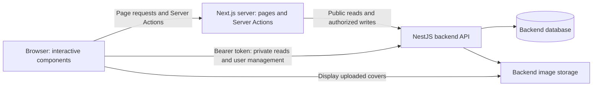

# BlogHub frontend architecture

This document describes the current frontend implementation. The frontend is a Next.js App Router application that connects to the separate BlogHub NestJS backend. The backend owns authentication rules, authorization, stored blog content, uploaded images, and the database.

## Technology stack

| Technology | Responsibility |
| --- | --- |
| Next.js 16.4 / React 19.3 | Routing, Server Components, Server Actions, and interactive UI |
| TypeScript | Component props, API response types, and application logic |
| Tailwind CSS 4 and global CSS | Styling, layout, responsive behavior, and theme variables |
| Tiptap | Visual editing with Markdown content |
| React Markdown and remark-gfm | Article and editor preview rendering |
| Zustand | Shared authentication state and actions |
| Sonner | Toast notifications for authentication and workspace actions |
| Vitest | Component and application logic tests |
| Playwright | Browser flows against an isolated mock API |

## Application boundaries



Public pages fetch content on the Next.js server. Authentication forms call Server Actions, which communicate with the backend and manage the frontend refresh cookie. Private workspace reads and user management call the backend from the browser using an access token. Content writes forward that token through a Server Action so cache invalidation follows a successful write.

The frontend has no database connection and no custom API route proxy. Content Server Actions handle post editing, moderation, taxonomy changes, and cover uploads; the backend remains responsible for authorization.

## Folder structure

```text
blog_frontend/
├── action/
│   ├── action.ts              # Authentication Server Actions
│   └── content.ts             # Public taxonomy reads and content writes with invalidation
├── app/                      # Routes, layouts, global styles, and theme control
│   ├── blogs/[slug]/          # Public article
│   ├── dashboard/            # Profile and author/admin workspace
│   ├── login/
│   ├── register/
│   └── fonts/                # Local Geist font files
├── components/               # Shared UI and feature components
├── lib/
│   ├── api.ts                # API request functions and URL helpers
│   ├── content.ts            # Cached public stories and taxonomy
│   ├── session.ts            # In-memory access token and refresh coordination
│   └── editor.ts             # Post validation and Markdown editing helpers
├── store/
│   └── auth-store.ts         # Zustand account state and actions
├── type/
│   └── type.ts               # Application data, state, and component prop types
├── tests/
│   ├── frontend.test.tsx     # Unit and component tests
│   ├── auth-store.test.ts    # Zustand account state and session lifecycle tests
│   └── e2e/                  # Playwright flows and isolated mock backend
├── next.config.ts
├── package.json
└── Rule.md                   # Project implementation conventions
```

The current project uses root-level `app/`, `components/`, `lib/`, and the singular `action/` folder. There is no `src/` directory.

## Routes

| Route | Purpose | Access |
| --- | --- | --- |
| `/` | Journal, category discovery, search, and About section | Public |
| `/blogs/[slug]` | Published article and its metadata | Public |
| `/login` | Sign-in form | Public |
| `/register` | Author registration | Public |
| `/dashboard` | Profile workspace and My stories | Signed in |
| `/dashboard/posts/new` | Write a new story | Signed in |
| `/dashboard/posts/[id]/edit` | Edit an owned story | Owner |
| `/dashboard/taxonomy` | Category and tag management | Signed in, with role/ownership restrictions |
| `/dashboard/admin/posts` | Manage all stories | Admin |
| `/dashboard/admin/posts/[id]/edit` | Legacy URL; redirects to All stories | Admin workspace |

The UI calls the dashboard “Profile” or “My workspace,” while its URL remains `/dashboard`. Dashboard pages are marked to prevent search indexing.

Admin All stories retains Read, Publish/Unpublish, and confirmed Delete controls, without editor links. Owners edit posts through My stories, including admins' own posts. Admin publication controls use `PATCH /admin/blogs/:id/status`; owner controls use `PATCH /blogs/:id`. Admin unpublishing sets `publicationBlocked`, which disables owner publishing in both My stories and the editor while allowing draft edits. Only the admin status endpoint can publish the story again and clear the block. The backend enforces these rules.

Category management groups tags under expandable category rows. Authors see categories they created, plus categories containing their own tags; expanding a category shows only that author's tags. A category created by someone else provides grouping context and cannot be renamed by the author. Admins see and manage all categories and tags. The New tag category selector shows all categories for both roles, so an author can create a tag under another user's category even without owning any categories. The new tag belongs to its creator. Public discovery and the story editor also use all available categories and tags.

`DashboardShell` resolves the browser session before showing protected content. Signed-out users are redirected to login with a return path. Admin pages also check the displayed user's role. The backend must enforce authorization on every protected endpoint; a client-side guard is only a UI convenience.

## Layout and components

The root layout loads local fonts and global styles, supplies metadata, and adds a keyboard skip link. `AuthProvider` surrounds the shared Header, route content, and Footer. It creates a Zustand store for that component tree and starts session restoration after mounting.

| Component | Responsibility |
| --- | --- |
| `header.tsx` / `footer.tsx` | Shared site navigation and footer |
| `auth-provider.tsx` | Provides the Zustand store, starts session synchronization, and exposes `useAuth` |
| `auth-form.tsx` | Interactive login and registration forms |
| `dashboard-shell.tsx` | Session guard, workspace navigation, and bottom sign-out button |
| `search-filters.tsx` | URL-backed search and category/tag/author filters |
| `post-list.tsx` | Public story cards and pagination |
| `post-manager.tsx` | Workspace story lists and publication/deletion controls |
| `post-editor.tsx` | Post fields, saving, cover selection, and local recovery |
| `rich-editor.tsx` | Visual Markdown editing with Tiptap |
| `taxonomy-manager.tsx` | Category and tag forms and management |
| `markdown.tsx` / `blog-image.tsx` | Safe article rendering and image display |
| `confirm-dialog.tsx` | Confirmation for destructive operations |

Server Components remain the default for route composition and public rendering. Client Components handle forms, browser storage, session state, theme switching, and the editor.

## Public content and search

The homepage requests blogs, categories, and tags from the backend. Search state lives in the URL through `q`, `category`, `tag`, `author`, and `page` parameters. This makes filtered views shareable and supports browser navigation.

Submitting filters updates the URL and resets pagination. Tags are limited to the selected category, and changing categories clears the selected tag. The backend returns the filtered results and pagination information.

The article page fetches by slug. React `cache` shares the article request between metadata generation and rendering within the server render. Missing articles use the not-found flow. Request-time sections have Suspense loading states.

The shared request helper uses `cache: "no-store"` to keep private requests fresh. `lib/content.ts` wraps public story lists, articles, and taxonomy in Next.js `use cache`, keyed by function arguments, with `blogs` and `taxonomy` tags. Entries revalidate after 60 seconds and expire after 120 seconds, with client stale time set to zero. Successful content Server Actions immediately expire affected tags using `updateTag`; taxonomy writes invalidate both tags because stories embed taxonomy. Changes made directly to the backend follow the time-based refresh. Existing open pages do not receive live updates. Article dates use a fixed UTC timezone.

## API layer

[`lib/api.ts`](lib/api.ts) is shared by server and browser code. It contains query-string helpers, image URL resolution, error formatting, and the shared `apiRequest(route, method = "GET", options)` function. The optional options argument carries bodies and headers. Application types live in [`type/type.ts`](type/type.ts) and are imported with `import type`, including API models, request inputs, authentication state, editor recovery data, and component props. All backend endpoint paths and payload construction live here in exported functions such as `getBlogs`, `saveBlog`, `getCategories`, and `saveTaxonomy`. Pages and components call these functions instead of constructing requests. Protected functions receive the authenticated `api` function from `AuthProvider`, preserving token refresh and session handling without importing browser session state into the shared module.

For example, a Server Component calls `await getBlogs({ page: 1, limit: 9 })`. A protected Client Component gets `api` from `useAuth()` and calls `await getCategories(api)` or `await saveBlog(input, id, imageFile, api)`. Add future backend endpoints to this module and reuse `apiRequest` for transport and error handling.

Requests use `NEXT_PUBLIC_API_BASE_URL`, defaulting to `http://localhost:5300/api/v1`. The request helper applies a timeout, parses JSON responses, handles empty responses, and turns backend failures into `ApiError` objects with a status and readable message.

JSON requests receive a JSON content type. `FormData` requests leave that header unset so the browser can generate the multipart boundary correctly.

The backend remains the source of truth for validation and permissions. Frontend validation provides earlier feedback but does not replace backend checks.

## State management

[`store/auth-store.ts`](store/auth-store.ts) uses Zustand for shared account state: `user`, `loading`, and `error`, together with login, logout, restore, and authenticated request actions. Existing components access it through `useAuth()` in `auth-provider.tsx`. The small React context only provides the store instance; Zustand manages state and subscriptions.

The provider creates a fresh store with the same initial values during server and browser rendering, following [Zustand’s Next.js guidance](https://zustand.docs.pmnd.rs/learn/guides/nextjs). Authentication work starts in an effect. There is no persisted Zustand state; access tokens stay in session memory and the refresh token stays in the HttpOnly cookie.

Form inputs, dialogs, story lists, taxonomy data, and editor drafts remain local component state. URL filters and the existing theme and draft recovery storage retain their current responsibilities.

## Authentication and session lifecycle

Authentication Server Actions live in [`action/action.ts`](action/action.ts):

- `submitAuthAction`: validates submitted fields and calls login or registration.
- `refreshSessionAction`: forwards the refresh cookie to the backend and returns an access token.
- `logoutAction`: signs out through the backend and clears the frontend refresh cookie on success.

```mermaid
sequenceDiagram
    participant UI as Browser / AuthProvider
    participant Action as Next.js Server Action
    participant API as Backend
    UI->>Action: Submit login form
    Action->>API: POST /auth/login
    API-->>Action: Access token and refresh cookie
    Action-->>UI: Access token; frontend HttpOnly cookie
    UI->>API: GET /auth/me with Bearer token
    API-->>UI: User profile
    Note over UI: Access token stays in memory
```

The backend refresh cookie is explicitly copied to a frontend `bloghub_refresh` cookie. It is HttpOnly, uses `SameSite=Lax`, has a root path, and is secure in production. Server Actions forward the cookie and request origin through `requestAuthSession` in `lib/api.ts`. Its response callback lets the action copy or clear cookies while shared request handling parses responses and errors. Server-side fetch does not automatically transfer backend cookies to the browser.

[`lib/session.ts`](lib/session.ts) keeps the access token and expiry in browser memory, not local storage. It refreshes a token near expiry and retries an authenticated request once after a 401. Network failures on mutations are not automatically retried.

Session restoration runs when `AuthProvider` mounts: refresh the session, then request `/auth/me`. A shared refresh promise coordinates calls within a tab; Web Locks coordinate session operations across tabs where available. BroadcastChannel communicates login and logout to other tabs. Stale restoration results are ignored so they cannot overwrite a newer session decision.

Registration displays a success message and directs the user to sign in. Return paths are checked to keep redirects within the frontend. Sign-out is at the bottom of the workspace sidebar and clears the account's local recovery copies after successful logout.

## Story editing and local recovery

The editor loads categories, tags, and the existing story when editing. New stories require a category, category changes clear tags, and a story can have at most ten tags. Existing Uncategorized stories can remain unassigned.

Visual editing, Markdown source, and Preview share the story content. The original Markdown is preserved until an actual edit. Detected advanced Markdown constructs stay in source mode to avoid changing formatting through the visual editor.

Save and publish create or update stories through the API. Publishing and unpublishing change status; permanent deletion requires confirmation. Successful saves update the editor's saved baseline and notify workspace lists to refresh. Failed saves keep the user's writing and selected file available for another attempt.

Recovery copies are stored locally by user and post under `bloghub-recovery:<userId>:<postId-or-new>`. They include draft fields, a save timestamp, and the server version timestamp. The editor offers Restore or Discard and highlights when the server story has changed since the recovery copy was made.

Recovery updates after a short delay and before saving or leaving. It is not backend autosave. Successful saving and explicit logout clear recovery copies. Unsaved-change warnings cover marked in-app links, sign-out, closing/reloading, and history navigation where the browser supports the Navigation API.

## Device cover images

Users select a JPEG, PNG, or WebP cover from their device, up to 5 MB. The editor validates the selection and creates a temporary object URL for preview. It revokes that URL when it is replaced or no longer needed.

The selected `File` stays in memory until save or publish. With a selected file, the editor sends `FormData` containing the story fields and an `image` field. Tag IDs are JSON-encoded within the multipart body. Without a new file, the editor sends JSON; removing a saved cover sends `coverImageUrl: null`.

The backend validates the file contents, stores the image, and returns a relative `/images/...` path. `blogImageUrl` resolves supported generated paths against the backend origin, while retaining support for existing HTTP(S) covers. Images load directly from that origin with a display fallback on failure.

Local recovery preserves the writing and saved cover reference, but cannot restore a selected device file after reload. The user must select that file again. Device uploads currently apply to cover images; inline editor images still use URLs.

## Theme, rendering, and safety

The header's final control toggles dark mode with sun/moon icons. Global CSS uses theme variables for light, dark, and system preferences. An early root-layout script applies a saved `bloghub-theme` preference before paint. The client toggle persists explicit choices and listens for theme changes across tabs and system preference changes.

Articles and previews use the shared Markdown renderer. Raw HTML is skipped, link protocols are restricted, and images pass through the image URL helper. This avoids treating authored Markdown as trusted HTML. Uploaded image paths are restricted to the backend's supported generated format.

Pending states prevent duplicate submissions. Forms and pages show readable API errors, protected screens offer session retries, and destructive operations require confirmation.

A shared Sonner `Toaster` is mounted in the root layout, outside route content, so notifications survive in-app redirects. Authentication, story mutations, image validation, and taxonomy actions call `toast.success` or `toast.error` from their client handlers. Toast colors inherit the site's theme variables. Form errors and persistent recovery/loading notices remain inline; background loading does not generate repeated toasts.

Category and tag pencil buttons open a native modal dialog with the current name and Save/Cancel controls. The dialog traps focus, supports Escape when idle, and keeps entered text and validation errors visible after a failed save. Successful renaming closes the dialog and reloads the entries. Delete buttons continue to use a separate confirmation dialog.

## Runtime and deployment requirements

- Run a Next.js server; Server Actions require server execution.
- Set `NEXT_PUBLIC_API_BASE_URL` before building. It is public browser configuration and must not contain secrets.
- Both the browser and Next.js server must be able to reach the configured backend.
- Configure the backend's `FRONTEND_ORIGINS` to include the frontend origin.
- Use HTTPS in production for secure session cookies.
- Keep uploaded `/images/...` resources reachable on the backend origin.

Normal output goes to `.next`. Browser tests set `BLOGHUB_TEST_BUILD=1` and use `.next-test` to isolate their build from local development. This repository does not include a deployment pipeline.

## Verification

| Command | Purpose |
| --- | --- |
| `npm run lint` | ESLint checks |
| `npm run typecheck` | Generate Next.js route types and check TypeScript |
| `npm test` | Vitest unit and component tests |
| `npm run build` | Production build |
| `npm run test:e2e` | Playwright browser flows |

Unit tests cover API handling, authentication actions and cookies, session coordination, Markdown safety, editor validation, and image URL handling. Browser tests cover discovery, authentication, writing, recovery, taxonomy, moderation, theme behavior, and cover uploads.

Playwright uses an in-memory mock backend on port 5301 and a production frontend on port 3001. It does not use the real backend database. A live backend integration check is still needed before release, especially for authentication, ownership, image storage, and administrative operations.

## Making future changes

Follow [`Rule.md`](Rule.md) and read the relevant installed Next.js guide before changing implementation. Keep public rendering on the server and introduce client code where interaction requires it. Reuse the API layer, session provider, Markdown renderer, and existing feature components rather than adding parallel implementations.

When the API contract changes, review request types and payloads, affected forms, response rendering, and both test layers. Update this document when a route, data flow, session boundary, or persistence strategy changes.

For startup instructions and current limitations, see [`README.md`](README.md).
